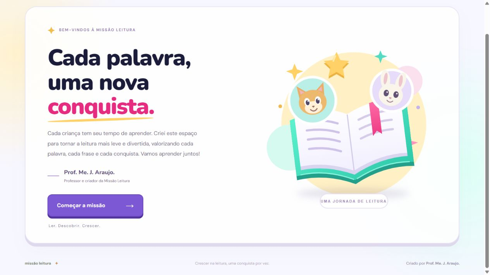

# Missão Leitura

**Criado por Prof. Me. J. Araujo.**

Jogo de fluência leitora para a sala de aula, com palavras e frases em escadinha, tempo ajustável, avatares e conquistas individuais.

- Jogo publicado: https://missao-leitura-pavio-27out.joilson-prof.chatgpt.site
- GitHub Pages: https://joilsonchaves.github.io/missao-leitura/

## Usar na sala

Abra o jogo, preencha o nome e a turma, escolha o animalzinho e configure a leitura. O professor ouve o aluno e marca os acertos ou as palavras com dificuldade. O aplicativo não reconhece a voz automaticamente.

Há palavras simples, complexas e mistas, 84 frases prontas e listas personalizáveis. O modo de projeção amplia o texto. A preparação de 10 segundos, os sons e as cores das palavras podem ser ligados ou desligados.

## Estrelas e prêmios

As estrelas acumulam até a professora reiniciar, sem zerar a cada semana. As metas padrão são 10, 25, 30, 40, 50, 60, 70, 80, 90 e 100 palavras corretas.

O mural permite retirar uma estrela, zerar para recomeçar, registrar um prêmio ou premiar e reiniciar. O histórico preserva quantas metas de 10 estrelas cada aluno concluiu, quantos prêmios recebeu e as datas. A mesma meta não é contada duas vezes dentro de um ciclo. Ajustes podem ser desfeitos antes de uma nova rodada.

O painel separa palavras e frases, mostra os acertos e permite acompanhar a evolução. Resultados e conquistas podem ser exportados em CSV.

## Onde ficam os dados

Nomes, turmas, resultados, avatares e prêmios ficam no armazenamento do navegador de cada professora. Este repositório contém o código e materiais de demonstração; não contém registros de alunos. Os dados não se transferem automaticamente entre dispositivos ou entre o endereço do GitHub Pages e o outro endereço publicado. Guarde cópias pelos botões de exportação.

## Arquivos e execução

É um site estático em HTML, CSS e JavaScript, sem instalação de dependências e sem servidor de dados. Abra `index.html` no navegador ou sirva a pasta com um servidor HTTP local. As fontes podem ser carregadas do Google Fonts; há fontes alternativas quando elas não estiverem disponíveis.

- `app.js`: leitura, palavras, frases, avatares e painel.
- `reward-cycles.js`: ciclos de estrelas, metas e histórico de prêmios.
- `test-reward-cycles.mjs`: testes do controle de conquistas; execute com `node test-reward-cycles.mjs`.
- `Como-usar.txt`: guia de uso para as professoras.

Para publicar no GitHub Pages, escolha **Settings → Pages → Deploy from a branch → main → /(root)**. O arquivo `.nojekyll` mantém a publicação estática.

## Créditos dos materiais

A interface e os recursos foram preparados para o projeto Missão Leitura, de Prof. Me. J. Araujo. As frases em escadinha usam o modelo dos materiais pedagógicos fornecidos para o projeto. As 24 frases adicionais foram adaptadas de *Plaquinhas de leitura*, de **@profalilianecaria**, com ajustes de pontuação e concordância. As ilustrações da interface são vetoriais.
