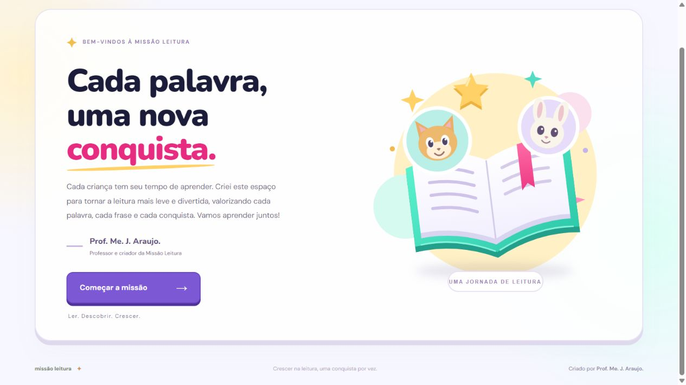

# Missão Leitura

**Criado por Prof. Me. J. Araujo.**

Jogo de fluência leitora para a sala de aula, com palavras e frases em escadinha, tempo ajustável, avatares e conquistas individuais.

- Jogo publicado: https://missao-leitura-pavio-27out.joilson-prof.chatgpt.site
- GitHub Pages: https://joilsonchaves.github.io/missao-leitura/

## Usar na sala

Abra o jogo, preencha o nome e a turma, escolha o animalzinho e configure a leitura. O professor ouve o aluno e marca os acertos ou as palavras com dificuldade. Há também gravação opcional e avaliação automática assistida, sempre com revisão da professora.

Há palavras simples, complexas e mistas, 84 frases prontas e listas personalizáveis. O modo de projeção amplia o texto. A preparação de 10 segundos, os sons e as cores das palavras podem ser ligados ou desligados.

## Estrelas e prêmios

As estrelas acumulam até a professora reiniciar, sem zerar a cada semana. As metas padrão são 10, 25, 30, 40, 50, 60, 70, 80, 90 e 100 palavras corretas.

O mural permite retirar uma estrela, zerar para recomeçar, registrar um prêmio ou premiar e reiniciar. O histórico preserva quantas metas de 10 estrelas cada aluno concluiu, quantos prêmios recebeu e as datas. A mesma meta não é contada duas vezes dentro de um ciclo. Ajustes podem ser desfeitos antes de uma nova rodada.

O painel separa palavras e frases, mostra os acertos e permite acompanhar a evolução. Resultados e conquistas podem ser exportados em CSV.

## Onde ficam os dados

Nomes, turmas, resultados, avatares e prêmios ficam no armazenamento do navegador de cada professora. Este repositório contém o código e materiais de demonstração; não contém registros de alunos. Os dados não se transferem automaticamente entre dispositivos ou entre o endereço do GitHub Pages e o outro endereço publicado. Guarde cópias pelos botões de exportação.

## Arquivos e execução

É um site estático em HTML, CSS e JavaScript, sem instalação de dependências e sem servidor de dados. Abra `index.html` no navegador ou sirva a pasta com um servidor HTTP local. As fontes podem ser carregadas do Google Fonts; há fontes alternativas quando elas não estiverem disponíveis.

- `app.js`: leitura, palavras, frases, avatares e painel.
- `reward-cycles.js`: ciclos de estrelas, metas e histórico de prêmios.
- `test-reward-cycles.mjs`: testes do controle de conquistas; execute com `node test-reward-cycles.mjs`.
- `Como-usar.txt`: guia de uso para as professoras.

Para publicar no GitHub Pages, escolha **Settings → Pages → Deploy from a branch → main → /(root)**. O arquivo `.nojekyll` mantém a publicação estática.

## Créditos dos materiais

A interface e os recursos foram preparados para o projeto Missão Leitura, de Prof. Me. J. Araujo. As frases em escadinha usam o modelo dos materiais pedagógicos fornecidos para o projeto. As 24 frases adicionais foram adaptadas de *Plaquinhas de leitura*, de **@profalilianecaria**, com ajustes de pontuação e concordância. As ilustrações da interface são vetoriais.

## Leitura com microfone

O modo opcional grava a leitura no dispositivo e oferece reconhecimento de palavras/frases em português, com revisão obrigatória da professora antes de registrar resultados ou estrelas. O reconhecimento depende da Web Speech API e pode enviar voz ao serviço do navegador; a interface solicita autorização explícita. Só gravar usa MediaRecorder sem envio pelo jogo. Áudio é temporário até a professora optar por guardar no IndexedDB ou baixar. Sem chaves de API ou backend. Os arquivos de áudio e as transcrições dos alunos não estão neste repositório.

`voice-reading.js` cuida da comparação de palavras, captura e armazenamento local; `voice-ui.js` integra a revisão, resultado e reprodução. Testes com reconhecimento e gravação simulados: `node test-voice-reading.mjs`. O teste não acessa um microfone nem um serviço externo.

## Primeiros passos

A nova área em `#aprender` oferece vogais com/sem imagem, encontros de vogais, alfabeto ilustrado, sílabas simples/complexas, formação de sílabas e montagem de palavras. Há sete atividades, cartelas ampliadas, letras maiúsculas/minúsculas, pistas graduais, modo tranquilo, rodadas sem cronômetro e sons suaves opcionais.

A professora registra sozinho, com apoio ou para retomar. O histórico tem filtros, revisão dirigida e CSV próprio. Essas atividades não aumentam palavras por minuto nem estrelas das missões de leitura. Os sons de conquista são gerados no dispositivo; ouvir vogais, sílabas e exemplos usa uma voz em português do navegador, quando disponível. A opção offline permite apenas vozes locais; outras vozes podem precisar de internet.

Os arquivos `literacy-data.js`, `literacy-ui.js` e `literacy.css` cuidam das atividades. Execute `node test-first-steps.mjs` para validar o conteúdo, as peças repetidas, apoios, registros e sons. `Guia-Primeiros-Passos.txt` explica o uso na sala de aula. As imagens de referência fornecidas pela professora orientaram a proposta; as cartelas digitais foram implementadas em HTML, sem republicar as fichas.

## Turmas e áudio de apoio

A capa mantém um único botão **Começar a missão**. No menu interno **O que vamos fazer?**, escolha a atividade. Preencher nome e turma ao começar cadastra o aluno automaticamente. **Minhas turmas** permite criar listas, selecionar alunos, escolher avatares e arquivar/restaurar cadastros. Tudo fica no navegador; nenhum cadastro de aluno faz parte deste repositório.

Os cartões têm áudio separado para vogal, sílaba ou encontro de vogais e para a palavra-exemplo. E/O oferecem também Ê/Ô. Ouvir um modelo durante a rodada é registrado como apoio. A prévia permite ouvir sem criar resultados. O texto público do cartão pode ser sintetizado por uma voz online do navegador; não usa microfone nem nomes de alunos.

Testes: `node test-roster.mjs`, `node test-roster-ui.mjs`, `node test-first-steps.mjs`. Consulte `Guia-Turmas-e-Sons.txt`.
